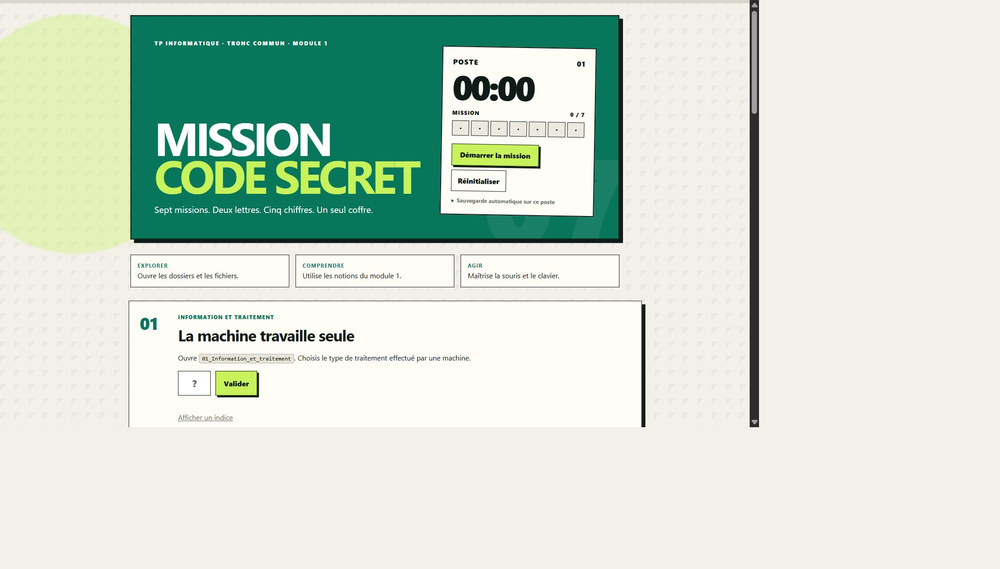
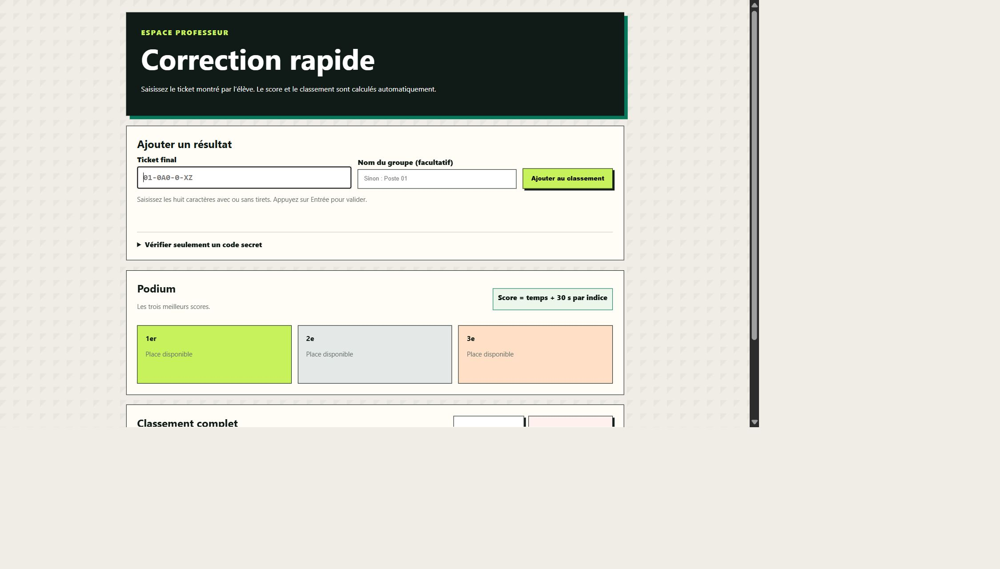

# Mission Code Secret

TP informatique hors ligne pour familiariser les élèves du tronc commun avec
le clavier, la souris, les dossiers, les fichiers et les notions du module 1.

## Fonctionnalités

- sept missions progressives ;
- codes différents pour 1 à 99 postes ;
- défi souris et défi de dactylographie de 90 secondes ;
- dix erreurs autorisées avant le redémarrage de la frappe ;
- sauvegarde locale et reprise du chronomètre ;
- ticket final court et signé ;
- correcteur avec podium, pénalité de 30 secondes par indice et export CSV.

## Utilisation

1. Double-cliquez sur **LANCER_GENERATEUR.bat**.
2. Indiquez le nombre de postes.
3. Copiez un dossier différent de **POSTES_GENERES** sur chaque ordinateur.
4. L’élève ouvre **index.html**.
5. Le professeur ouvre **CORRECTEUR_ENSEIGNANT.html**.

## Documentation

- [Guide enseignant](README_ENSEIGNANT.md)
- [Guide de publication GitHub](docs/GUIDE_PUBLICATION_GITHUB.md)
- [Guide de personnalisation](docs/GUIDE_PERSONNALISATION.md)

## Licence

- code : licence MIT ;
- contenus pédagogiques : CC BY 4.0.

Les postes générés et la liste des réponses sont exclus de GitHub.

